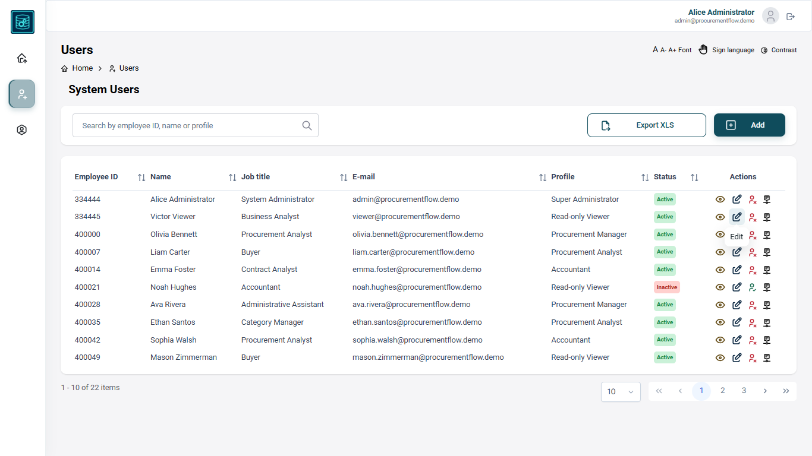

# ProcurementFlow

Enterprise procurement and budget-request management platform — fund requests,
multi-step approvals, vendor quotations — RFQ (Request for Quotation) — and price
analysis, built with Angular 18.



## Overview

ProcurementFlow handles the full procurement lifecycle for organizations that need
structured, auditable purchasing: internal budget requests, approval chains,
vendor quote collection and side-by-side price comparison.

Originally modeled on public-sector procurement processes, the application includes permission-based navigation and incorporates enterprise-level requirements such as compliance, traceability, multi-level authorization, and complex data workflows.The front end is built following the UX team's Design System to ensure visual consistency and a cohesive user experience across the application. These capabilities make it adaptable to a wide range of business environments.

It runs standalone — a mocked HTTP layer simulates the REST contract (`/api/v1`),
so no backend is required to evaluate it.

## Highlights

- **Design System-Based UI Development** — custom Angular layouts built following UX-defined design standards to ensure consistent and reusable interface patterns
- **Permission engine** — a single source of truth (`FeatureCode` + `ActionCode`)
  shared by the API mock, route guards and
  navigation, enforcing least-privilege access at route and action level.
- **Route protection** — functional `authGuard`, `loginGuard` and `permissionGuard`.
- **Procurement workflows** — request creation, approval steps, RFQ tracking,
  quote comparison with Chart.js dashboards and PDF/ Excel export.
- **Accessibility** — font scaling and high-contrast controls built into the UI.
- **Enterprise structure** — standalone components, layered folders
  (`core/`, `guards/`, `interceptors/`, `services/`), strict TypeScript.

## Tech Stack

Angular 18 · TypeScript 5.5 · PrimeNG 17 · Tailwind CSS · RxJS · REST APIs · Swagger / OpenAPI
Chart.js · Azure Pipelines

## Quick Start

```bash
git clone https://github.com/thiagocarvalhocan/ProcurementFlow.git
cd ProcurementFlow
npm install
npm start        # http://localhost:4200 — mock API, no backend needed
```

Production build: `npm run build` → `dist/procurement-flow/browser`

## Architecture

```
src/app/
├── core/           # auth session, feature codes, mock API (database · handlers)
├── guards/         # auth · login · permission
├── interceptors/   # auth interceptor · mock API interceptor
├── services/       # 17 domain services
├── pages/          # route components
├── components/     # layout, toolbar, dialogs, accessibility
└── shared/         # reusable components, pipes, directives, validators
```

The mock interceptor mirrors the real API contract, so pointing the app at a
live backend requires only an environment change.

## Testing

```bash
npm test
```

78 spec files covering route guards (including the full navigation permission
matrix), directives, pipes and components. CI (Continuous Integration) runs on
Azure Pipelines: build → artifact → multi-server IIS (Internet Information
Services) deployment per environment (Dev / Hom / Prod).

## Author

**Thiago Gusmao de Carvalho** — Front-end Developer

- GitHub: [@thiagocarvalhocan](https://github.com/thiagocarvalhocan/ProcurementFlow)
- LinkedIn: [_(link)_](https://www.linkedin.com/in/thiago-carvalho-gusmao/)